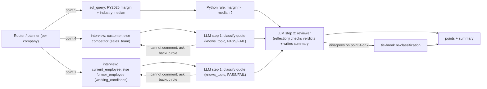

# FTEC5660 Homework 3: Fisher's 15-Point Investment Agent

Build a LangChain agent that researches a company with tools and applies the
framework from Philip Fisher's _Common Stocks and Uncommon Profits_ (Part One,
Chapter 3 "What to buy: the fifteen points to look for in a common stock", and
Chapter 4 "What to buy: applying this to your own needs"). You choose 3 of
Fisher's 15 points and decide yourself what PASS means for each. For every
company your agent gives a PASS/FAIL verdict on your 3 points and a short
summary.

The companies are fictional, so the model cannot answer from memory. Unlike a
pile of reports, the evidence is spread over three sources, and your agent has
to go and get it with tools, the way Fisher's "scuttlebutt" method sends an
investor to talk to customers, competitors, suppliers and staff.

## Data and tools

`public_test/` has one folder per company. Your code receives four tools per
company (built by the provided code in `hw3.py`):

| Tool                     | What it gives you                                                                                                                |
| ------------------------ | -------------------------------------------------------------------------------------------------------------------------------- |
| `list_documents()`       | the company's six documents and their dates                                                                                      |
| `read_document(name)`    | one document: the 2025 letter to shareholders, four earnings calls (Q3 2025 to Q2 2026) and a news file (July 2025 to July 2026) |
| `sql_query(query)`       | one read-only SQLite query on the company's database; at most 50 rows come back, so use `SUM`, `GROUP BY` and `WHERE`            |
| `interview(role, topic)` | what one person says about the company; at most **10 interviews per company**                                                    |

The documents are what management says. Management's own claims (such as "we
have never cut research" or "our people are our greatest strength") are not
evidence on their own: check them against the database and the interviews.

**Database tables** (amounts in USD thousands; dates `YYYY-MM-DD`, months
`YYYY-MM`, quarters like `2025Q3`; the fiscal year is the calendar year):

| Table              | Columns                                                                                                                                                                   |
| ------------------ | ------------------------------------------------------------------------------------------------------------------------------------------------------------------------- |
| `company`          | name, industry                                                                                                                                                            |
| `industry_medians` | industry, revenue_growth_2y_pct, new_product_share_pct, new_product_sales_per_rd, operating_margin_pct (one row per industry; use the row for the company's own industry) |
| `orders`           | order_id, order_date, product, customer, amount, note (about 3,000 to 4,000 orders from January 2023 to June 2026; revenue is the sum of order amounts)                   |
| `products`         | product, launch_date                                                                                                                                                      |
| `monthly_costs`    | month, cost_of_sales, selling_admin, research_development                                                                                                                 |
| `quarterly_cash`   | quarter, operating_cash_flow, capex, cash_end                                                                                                                             |
| `capex_plan`       | year, planned_capex (2026 to 2028)                                                                                                                                        |
| `returns`          | month, units_shipped, units_returned                                                                                                                                      |
| `insider_trades`   | trade_date, person, title, side (`buy` or `sell`), shares, price                                                                                                          |

**Terms used in the data.**

| Term                         | Meaning                                                                                                                                                                                      |
| ---------------------------- | -------------------------------------------------------------------------------------------------------------------------------------------------------------------------------------------- |
| FY2025                       | Fiscal year 2025. Here the fiscal year is the calendar year, so FY2025 is January to December 2025.                                                                                          |
| Quarter                      | Three months of the year: Q1 is January to March, Q2 April to June, Q3 July to September and Q4 October to December. The database writes `2025Q3`; the documents write "third quarter 2025". |
| Amounts                      | The database is in **USD thousands** (676,100 means US$676.1 million). The documents use USD millions.                                                                                       |
| Revenue                      | Money from sales: the sum of `amount` in `orders`.                                                                                                                                           |
| Cost of sales                | The cost of making the products that were sold.                                                                                                                                              |
| Selling and admin            | The cost of selling and of running the company (sales staff, offices, management).                                                                                                           |
| R&D                          | Research and development spending, mainly on new products.                                                                                                                                   |
| Operating margin             | Operating profit as a share of revenue: (revenue − cost of sales − selling and admin − R&D) ÷ revenue.                                                                                       |
| Operating cash flow          | Cash that the day-to-day business brings in during a quarter.                                                                                                                                |
| Cash at the end of a quarter | The cash the company holds on the last day of that quarter (`cash_end`).                                                                                                                     |
| Capex                        | Capital expenditure: spending on factories, machines and other long-term assets. `capex_plan` holds the planned capex for 2026 to 2028.                                                      |
| Return rate                  | Units returned ÷ units shipped, from the `returns` table.                                                                                                                                    |
| Industry median              | The middle value for companies in the same industry, from `industry_medians`.                                                                                                                |
| Insider                      | A director or senior manager of the company. `insider_trades` lists the shares they bought (`buy`) or sold (`sell`).                                                                         |
| Earnings call                | A meeting each quarter where management presents the quarter's results to investors. Each call quotes that quarter's revenue.                                                                |

**Interviews.** Roles: `customer`, `current_employee`, `former_employee`,
`competitor`, `supplier`. Topics: `sales_team`, `working_conditions`,
`top_management`, `decision_making`, `competitive_edge`. Only some people know
about each topic; the others say they can't comment, and that answer still
uses up one interview.

| Topic                | Who knows about it                |
| -------------------- | --------------------------------- |
| `sales_team`         | customer, competitor              |
| `working_conditions` | current_employee, former_employee |
| `top_management`     | former_employee, supplier         |
| `decision_making`    | supplier, customer                |
| `competitive_edge`   | competitor, customer              |

People who know about a topic always agree with each other, so one good answer
is enough.

## Choose your 3 points and your rules

Pick any 3 of Fisher's 15 points and write them in `CHOSEN_POINTS` near the
top of `hw3.py`, e.g. `CHOSEN_POINTS = [1, 7, 15]`. The full questions are in
`FISHER_POINTS` in `hw3.py` and in the book.

| #   | Fisher's point                           | Where the evidence is                        |
| --- | ---------------------------------------- | -------------------------------------------- |
| 1   | Market potential for sales growth        | database                                     |
| 2   | New products as current lines mature     | database                                     |
| 3   | Effective research and development       | database                                     |
| 4   | Above-average sales organization         | interviews (`sales_team`)                    |
| 5   | Worthwhile profit margin                 | database                                     |
| 6   | Maintaining or improving margins         | database                                     |
| 7   | Labour and personnel relations           | interviews (`working_conditions`)            |
| 8   | Executive relations                      | interviews (`top_management`)                |
| 9   | Depth of management                      | interviews (`decision_making`)               |
| 10  | Cost analysis and accounting controls    | earnings calls, checked against the database |
| 11  | Advantage over competitors               | interviews (`competitive_edge`)              |
| 12  | Long-range outlook on profits            | database                                     |
| 13  | Growth without dilutive equity financing | database                                     |
| 14  | Management talks freely about troubles   | earnings calls, checked against the database |
| 15  | Management of unquestionable integrity   | news file, checked against the database      |

For each of your points, **you design the rule**: which evidence to use, what
to compute or whom to ask, and where the line between PASS and FAIL lies. PASS
means the company looks favourable on that point, as Fisher would see it.

We grade your verdicts against our own answer key. It uses one fixed rule per
point, which we do not publish, and the data never puts a company close to
the line of that rule, so a sensible reading of Fisher usually gives the same
answer. **Test your rules on the public answers**:
`public_test/ground_truth.json` gives the expected verdict on all 15 points
for each of the 20 public companies, and every point fails in 6 of them. If
your rule disagrees with the public answers, rethink it.

**Tip: calculate with tools, not in your head.** Do every sum, ratio and
comparison in SQL or Python, including the number of days between two dates
(SQLite's `julianday()` gives a date as a number of days).

## Student task

Fill in the three places in `hw3.py` marked `### YOUR CODE HERE`. You may add
imports, constants and helper functions above them, but do not change the
provided code below them:

- `CHOSEN_POINTS` lists your 3 points.
- `build_agent()` creates your model and anything else you need once.
- `analyze_companies(agent, companies)` receives
  `{company_folder: [list_documents, read_document, sql_query, interview]}`
  and returns, for every company,
  `{"points": {1: "PASS", 7: "FAIL", 15: "PASS"}, "summary": "..."}` (here with
  `CHOSEN_POINTS = [1, 7, 15]`).

Use the course techniques that fit your points: tool use for the database and
the interviews, planning which interviews to spend, routing each point to the
right source, prompt chaining, parallel calls, reflection to check your
answers, or a combination. Your code must read company data **only through
the four tools**; do not open `company.db` or `interviews.dat` yourself. Do
not hard-code folder names, company names or the public answers.

## Setup and public test

```bash
python3 -m venv .venv
source .venv/bin/activate
pip install -r requirements.txt
echo "DEEPSEEK_API_KEY=your_key_here" > .env
python3 hw3.py --data-folder public_test
```

Use your own DeepSeek API key (from https://platform.deepseek.com). The
required model is `deepseek-v4-flash`. We grade with our own key, so never put
a key in your code; `.env` must stay out of git.

The program creates `results.csv` with the columns `company`, `points`,
`points_correct`, `point_errors`, `interviews_used` and `summary`, and prints
the point score on your 3 points (the percentage after "balanced"). The point
score is the average of two shares: the share of truly passing verdicts that
you marked PASS and the share of truly failing verdicts that you marked FAIL.
For example, 90% and 60% give (90% + 60%) / 2 = 75%, and marking every point
PASS gives (100% + 0%) / 2 = 50%. Once `CHOSEN_POINTS` is set, the starter
runs before you add any API code (it returns no verdicts, so it scores 0%).

`public_test/ground_truth.json` gives the expected verdicts on all 15 points
for each public company. Grading uses a private set of about 20 unseen
companies with the same tools and the same answer key rules, but different
names and wording, and scores your 3 points only.

## Homework 3 solution

**Chosen points:** `CHOSEN_POINTS = [4, 5, 7]`. These cover three different sides of a business
(how it sells, how much it earns, and how it treats its people) and both kinds of evidence: the
database for point 5 and Fisher's "scuttlebutt" interviews for points 4 and 7.

### My 3 points and rules

**Point 4: Above-average sales organization** (interviews, topic `sales_team`)

- _Why:_ Fisher argues that good products are not enough: "It is the making of a sale that is the
  most basic single activity of any business. Without sales, survival is impossible" (p. 59), and
  "for steady long-term growth a strong sales arm is vital" (p. 62). It is also a point that suits
  an agent with an interview tool, because the answer comes from outsiders: "Both competitors and
  customers know the answers. Equally important, they are seldom hesitant to express their views"
  (p. 59).
- _Rule:_ **PASS** if an informed outsider describes salespeople who know the product and the
  customer's line, give real advice and follow up quickly (for example "came the next day with an
  engineer"). **FAIL** if they are order-takers ("just send the price list", "we go to rivals for
  advice") or keep changing and don't know the product.
- _Evidence:_ `interview("customer", "sales_team")`, falling back to `competitor` if the customer
  can't comment.

**Point 5: Worthwhile profit margin** (database)

- _Why:_ Fisher calls this "a subject of importance which properly lends itself to the type of
  mathematical analysis" (p. 62), so it can be measured exactly with SQL. He compares margins within
  an industry: "The wide variation between different companies, even those in the same industry,
  will immediately become apparent" (p. 62). The big winners "have among the best such margins in
  their industry" (p. 63), and "the greatest long-range investment profits are never obtained by
  investing in marginal companies" (p. 62). That is why my threshold is the industry median rather
  than a fixed percentage.
- _Rule:_ **PASS** if the FY2025 operating margin, (revenue − cost of sales − selling & admin −
  R&D) ÷ revenue, is at least the industry median `operating_margin_pct` for the company's own
  industry. Otherwise **FAIL**.
- _Evidence:_ a single `sql_query` that joins yearly revenue from `orders`, yearly costs from
  `monthly_costs`, and the matching `industry_medians` row. All arithmetic runs in SQL and the
  comparison runs in Python, never in the LLM.

**Point 7: Outstanding labour and personnel relations** (interviews, topic `working_conditions`)

- _Why:_ "Most investors may not fully appreciate the profits from good labor relations. Few of
  them fail to recognize the impact of bad labor relations" (p. 65). The signs Fisher lists are the
  ones my rule looks for: "the relative labor turnover," whether the company is "making every effort
  to settle grievances quickly," and whether it pays "above-average wages for the area" (p. 67).
  He also notes that "a record of constant and prolonged strikes is a good indication of bad labor
  relations" (p. 66). The workforce knows these things best, so the agent asks employees.
- _Rule:_ **PASS** if an employee reports fair pay, low turnover ("people stay for years") and
  grievances that get fixed. **FAIL** for constant overtime, monthly resignations, low morale or
  strike threats.
- _Evidence:_ `interview("current_employee", "working_conditions")`, falling back to
  `former_employee`.

### Design



<details>
<summary>Plain-text version of the diagram (for viewers without Mermaid)</summary>

```
                    +-------------------------------+
                    | Router / planner (per company)|
                    +-------------------------------+
                      | point 5        | point 4               | point 7
                      v                v                       v
        +------------------------+  +--------------------+  +-----------------------------+
        | sql_query              |  | interview          |  | interview                   |
        | FY2025 op. margin and  |  | customer           |  | current_employee            |
        | industry median        |  | (else competitor)  |  | (else former_employee)      |
        +------------------------+  | topic: sales_team  |  | topic: working_conditions   |
                      |             +--------------------+  +-----------------------------+
                      v                      |    ^ can't comment |    ^ can't comment
        +------------------------+           v    |               v    |
        | Python rule            |  +--------------------+  +-----------------------------+
        | margin >= median ?     |  | LLM step 1:        |  | LLM step 1:                 |
        | (no LLM arithmetic)    |  | classify quote     |  | classify quote              |
        +------------------------+  +--------------------+  +-----------------------------+
                      |                      |                        |
                      +----------------------+------------------------+
                                             v
                      +-----------------------------------------------+
                      | LLM step 2: reviewer (reflection)             |
                      | checks each verdict vs. evidence, writes      |
                      | summary; disagreement on 4/7 -> tie-break     |
                      +-----------------------------------------------+
                                             v
                               { points: {4,5,7}, summary }
```

</details>

For each company the agent first **routes** every chosen point to its evidence source and runs the
three branches **in parallel**. Companies also run in parallel, up to 8 at a time, so the 20 public
companies take about 15 seconds. Point 5 uses one aggregated SQL query through the `sql_query`
tool; the comparison is a deterministic Python rule, so the model never does arithmetic. Points 4
and 7 follow an **interview plan** that asks the role most likely to know first and only spends a
second interview if that person says they can't comment, so a company normally uses 2 of its 10
interviews. Each quote is classified by `deepseek-v4-flash` (JSON mode, temperature 0) against a
written rule. **Prompt chaining** then passes all evidence and verdicts to a second
`deepseek-v4-flash` call that acts as a **reflection** reviewer: it checks each verdict against its
rule and evidence and writes the investor summary. If the reviewer disagrees on an interview point,
a tie-break classification decides; it can never override the numeric SQL verdict. Errors are caught
at every level (per point, per company, plus a timeout): if the LLM is down, a keyword fallback and
template summary still produce a valid entry, so `results.csv` is always written.

### Results

`python hw3.py --data-folder public_test` gives **60/60 correct, balanced point score 100.0%**,
the same in three separate runs, with 2 interviews per company and about 15 seconds per run.

No company disagrees with the public answers. The margin rule has a comfortable gap everywhere: the
closest cases are Kestrel Technologies (10.01% vs an 8.30% median, PASS) and Halcyon Works (9.52%
vs 11.40%, FAIL). The interview quotes are unambiguous. One check I made along the way: comparing
against a fixed margin threshold would have failed, because the medians range from 8.3% to 16.8%.
Northwind Group (12.8%) fails while Kestrel (10.0%) passes, which only an industry-relative rule
explains, as Fisher suggests.

## Task 2: Reflection on AI sycophancy and AI psychosis

**Sycophancy** is a model's tendency to tell the user what they want to hear: agreeing with a wrong
premise, praising weak work, or changing a correct answer when the user pushes back. It comes
partly from training on human approval ratings, which reward answers that feel pleasant. In this
homework, the documents are exactly the material a sycophantic model would trust too much.
Management letters say "our people are our greatest strength", and a model eager to agree would
repeat that. That is why my agent never grades from management's words. Each verdict comes from
independent evidence (an employee's or customer's quote, or a SQL number), the reviewer prompt
tells the model not to recompute or second-guess exact figures, and the deterministic SQL verdict
cannot be overridden by the LLM at all.

**"AI psychosis"** is the informal name for cases where long, emotionally engaged conversations with
a chatbot reinforce a user's distorted or delusional beliefs. It is sycophancy compounded over many
turns: the model mirrors and amplifies the user's framing, the user reads that as independent
confirmation, and the loop drifts further from reality. Vulnerable or isolated users are most at
risk, because the chatbot becomes their main source of "validation".

The two are connected. Sycophancy is the mechanism and AI psychosis is one of its worst outcomes,
and the fix in both cases is grounding. An agent should anchor its claims in external evidence
(tools, data, other people) rather than in what the user already believes. It should be willing to
disagree, and keep humans and independent checks in the loop. Fisher's scuttlebutt method is an old
version of the same idea: don't take the story you are told at face value; go and ask people who
have no reason to flatter you.
